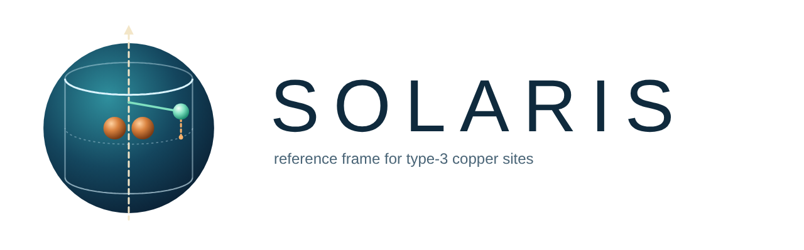

<p align="center">
  <picture>
    <source media="(prefers-color-scheme: dark)" srcset="docs/solaris_banner_dark.png">
    
  </picture>
</p>

**SOLARIS** (*Symmetry-Oriented Ligand Approach Reference In type-3 copper Sites*) places every structure or MD
frame of a type-3 copper protein in one common reference frame attached to the dicopper site, and describes the
active site in cylindrical coordinates (*h*, *r*, φ) around its pseudo-C2 axis.

See [TUTORIAL.md](TUTORIAL.md) for a step-by-step guide.

## Method

1. **Common frame.** The conserved core of each structure or frame (CuA, CuB and the imidazole rings of the six
   His, 32 atoms) is superposed by the Kabsch algorithm onto a family consensus template obtained by generalized
   Procrustes analysis. The core RMSD is reported for every structure/frame.
2. **Axes.** The origin is the Cu–Cu midpoint; *z* is the pseudo-C2 axis, i.e. the 180° rotation that best maps the
   CuA site (Cu + HisA1–A3) onto the CuB site (Cu + HisB1–B3) pairing A*k* with B*k*; *x* points to CuA and +*z* to
   the side of the conserved Glu/Asn (substrate entry).
3. **Coordinates.** *h* = *z*, *r* = √(*x*² + *y*²), φ = atan2(*y*, *x*). φ is reported only for
   *r* ≥ `r_min_phi` (2.5 Å by default) because the angle is ill-defined near the axis.

Because the frame moves with the active site, the coordinates are invariant to rigid-body motion and directly
comparable across enzymes.

## Descriptors

| Group | Descriptors |
|---|---|
| Landmarks | For CA, side-chain centroid (SC) and functional group (TIP): *x*, *y*, *h*, *r*, φ; d(TIP–CuA), d(TIP–CuB); side-chain orientation *dr* = *r*(TIP) − *r*(CA) and *dh* = *h*(TIP) − *h*(CA) |
| Substrate (L-Tyr) | Position of OH, ring and CA; d(OH–CuA), d(OH–CuB), d(C*ortho*–O peroxide); ring tilt to *z*; CA→OH and C–OH angles to −*z*; d(ring–HisB2), d(carboxylate–anchor), d(ring–gatekeeper) |
| π-stacking with HisB2 | angle between the L-Tyr and HisB2 ring planes, offset of the L-Tyr ring centre from the HisB2 normal, height above the HisB2 plane, stacking yes/no (d ≤ 5.5 Å, offset ≤ 2 Å, angle ≤ 30° or ≥ 60°) |
| Cu2O2 core | d(Cu–Cu), d(O–O), CuA–O1–O2–CuB dihedral, Cu2O2 plane tilt, max d(Cu–NE2), core RMSD |

## Installation

```bash
git clone https://github.com/tomascd123/SOLARIS.git
cd SOLARIS
pip install -r requirements.txt
```

MDAnalysis is only needed for trajectories; static structures are read as PDB files.

## Usage

```bash
python3 solaris.py examples/TYR_static.json --check         # residues and numbering only (example data included)
python3 solaris.py examples/TYR_static.json                 # full analysis
python3 solaris.py examples/TYR_static.json --figures-only  # redraw figures from saved tables
bash tools/run_gamd_per_enzyme.sh                           # GaMD trajectories, one enzyme at a time
```

| Option | Effect |
|---|---|
| `--only ScTYR BmTYR` | process only these enzymes |
| `--states global docking` | process only these states |
| `--no-gamd`, `--no-docking` | skip trajectories / docking poses |
| `--out DIR` | output folder (overrides `output_dir`) |
| `--strict` | stop instead of skipping a missing file |
| `--dpi N` | figure resolution |

`tools/renumber_like_docking.py` renumbers minimised structures so that they share the residue numbering of the
docking structure of the same enzyme.

## Configuration

One JSON file (see `examples/`); paths are relative to it.

```json
{
  "output_dir": "output_static",
  "r_min_phi": 2.5,
  "landmarks": {"Conserved_Glu": {"role": "Glu", "plot": "TIP"}},
  "systems": {
    "ScTYR": {
      "roles": {"HisA1": 38, "HisA2": 54, "HisA3": 63, "HisB1": 190, "HisB2": 194, "HisB3": 216,
                "Glu": 182, "Asn": 191, "anchor": 55, "gatekeeper": 204, "SerAla": 206},
      "structures": {
        "global": "structures/ScTYR/ScTYR_global_renum.pdb",
        "docking": {"pdb": "structures/ScTYR/ScTYR_dock_prepared.pdb", "peroxide": {"resname": "PER", "atoms": ["O1", "O2"]}},
        "GaMD": {"top": "1wx2.parm7", "traj": ["1wx2_prod.nc"], "stride": 10}
      }
    }
  }
}
```

- **Roles** are residue numbers in one reference numbering per enzyme (`"A:182"` selects a chain). In files where the
  six His are named HD1–HD6 (MCPB.py topologies), the numbering offset is detected automatically; otherwise
  `resid_offset` (default 0) is used. Residue types are checked (His, Glu, Asn) and every role must map to the same
  residue type in all states.
- **State names** set the category: `global*`, `local*`, `docking*`, and `gamd*`/`md*`/`traj*` for trajectories.
- **Ligand and peroxide** residue and atom names can be set globally, per enzyme or per state (`ligand`, `peroxide`).
- Other keys: `dpi`, `r_color` (colour scale of *r* in F2), `points_per_trajectory` (frames drawn per trajectory),
  `tip_atoms` (per enzyme), `start`/`stop`/`stride` (per trajectory).

## Output

A reference output for the example structures is in `examples/output_static/`.

| Path | Content |
|---|---|
| `tables/descriptors_per_frame.csv` | one row per structure/frame, all descriptors |
| `tables/landmarks_long.csv` | long format: *x*, *y*, *h*, *r*, φ, d(CuA), d(CuB) per point |
| `tables/state_summary.csv` | mean, SD, p10, median, p90 per state (circular mean/SD for φ) |
| `tables/percentile_in_trajectory.csv` | percentile of each static structure within its trajectory |
| `tables/residue_QC.csv` | residue used for each role in each state |
| `tables/pistack_geometry.csv` | L-Tyr ring and HisB2 seen down the HisB2 normal (input of F4) |
| `figures/F1_landmark_summary.png` | *r*, *h* and φ of every landmark across the family |
| `figures/F1_per_landmark/` | one top view (down the pseudo-C2 axis) per pocket landmark shared by ≥ 2 enzymes |
| `figures/F2_unrolled_cylinder.png` | φ vs *h* per landmark, colour = *r* |
| `figures/*_GaMD*` | the same figures for trajectories (50/90 % density and subsampled frames) |
| `figures/F3_GaMD_<enzyme>.png` | all landmarks of one enzyme along its trajectory |
| `figures/F4_pistacking_HisB2.png` | L-Tyr ring over HisB2, one panel per enzyme (GaMD: % of frames stacked) |
| `SUMMARY.md` | checks, residues used and key values per state |

## Citation

If you use SOLARIS, please cite: *Castro, T. et al.* (in preparation).

## License

MIT, see [LICENSE](LICENSE).
